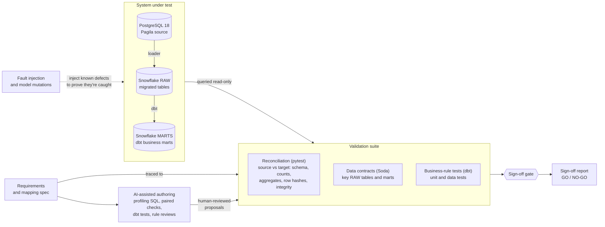

# Pagila → Snowflake migration QA

Automated data-quality validation for a PostgreSQL 18 → Snowflake migration and the dbt transformations built on it. Every check traces to a written requirement, fault injection proves that the checks detect defects, and a sign-off gate turns the results into a go/no-go decision.

The source is [Pagila](https://github.com/devrimgunduz/pagila), the PostgreSQL port of the Sakila sample database: a DVD-rental business in 16 tables. Its schema includes the types that commonly break migrations: a partitioned table, enums, domains, arrays, `tsvector`, `bytea`, and pgvector embeddings.

## Approach



## Validation layers

Each check traces to a requirement in [requirements/requirements.yml](requirements/requirements.yml).

| Layer | Requirement | Checks | Catches |
|---|---|---|---|
| Spec | MIG-001 | Mapping spec vs live source catalog | Unmapped columns, source type drift |
| Schema | MIG-002 | Target columns, types, nullability, constraints vs spec | Wrong DDL, missing constraints |
| Volume | MIG-003, MIG-006 | Row counts; load log | Dropped or duplicated rows, failed loads |
| Aggregate | MIG-004 | Per column: nulls, distinct, min, max, sum, text length | Truncation, shifted values, type changes |
| Row | MIG-005 | Normalized hash per primary key, source vs target | Any changed, missing, or extra row, by key |
| Integrity | MIG-007, MIG-008 | Orphans across 23 relationships; domain rules | Broken references (Snowflake doesn't enforce FKs) |
| Contract | MIG-009, ETL-008 | Soda contracts on key RAW tables and the marts | Schema, uniqueness, required and valid values |
| Business rule | ETL-001 to ETL-007 | dbt unit and data tests; marts vs an independent Postgres implementation | Rule logic, boundary cases, join fan-out |

Source-to-target checks are pytest (`tests/reconciliation/`), contracts are Soda Core (`soda/contracts/`), and business rules are dbt tests. Cross-dialect normalization and contract coverage: [docs/reconciliation.md](docs/reconciliation.md).

## Results

| Report | Result |
|---|---|
| [Migration sign-off](reports/migration_signoff.md) | GO: 17 of 17 requirements pass |
| [Fault injection](reports/fault_matrix.md) | 12 of 12 injected migration faults detected |
| [dbt mutation testing](reports/dbt_mutation_matrix.md) | 17 of 17 model mutations detected |

## AI-assisted test authoring

Four Claude Code subagents ([.claude/agents/](.claude/agents/)) draft validation work for human review. Each was evaluated blind against known answers before use.

| Agent | Produces | Evaluation |
|---|---|---|
| `migration-check-author` | Paired Postgres/Snowflake validation SQL | No false alarms on clean data; detected 10 of 12 faults |
| `dbt-test-author` | dbt unit, data, and singular tests | Detected 17 of 17 model mutations; found a precision defect in a mart |
| `rule-reviewer` | Ambiguities and edge cases in a draft business rule | Recovered 12.5 of 13 known gaps, with no false findings |
| `dq-triage` | Diagnosis of a failing check: affected rows, root cause, fix | Scored 31 of 32 on four blind fault scenarios |

Agents use read-only database identities and write only to `proposals/`, and a reviewer promotes accepted output into the suite. Defects found in AI-generated work are recorded in [AI_LOG.md](AI_LOG.md).

## Quick start

Requires Docker, [uv](https://docs.astral.sh/uv/), and a Snowflake account. One-time setup: [docs/setup.md](docs/setup.md).

```bash
docker compose up -d                                              # PostgreSQL source on localhost:5434
uv run --env-file .env python -m migrate.load                     # migrate to Snowflake RAW
(cd dbt && uv run --env-file ../.env dbt build --profiles-dir .)  # build and test the marts
uv run --env-file .env pytest                                     # full validation suite
uv run --env-file .env python -m reconcile.signoff                # sign-off report; exits 1 on NO-GO
```

## CI

- **Pull requests** ([ci.yml](.github/workflows/ci.yml)): lint, then the tests that need only PostgreSQL, against a PostgreSQL 18 service container.
- **Full run** ([full-run.yml](.github/workflows/full-run.yml), started manually): fresh source, migration, dbt build, and the sign-off gate against Snowflake. The sign-off report is attached to the run.

## Documentation

- [docs/setup.md](docs/setup.md): Snowflake account, keys, connections, environment, and every command
- [docs/reconciliation.md](docs/reconciliation.md): cross-dialect normalization, data contract coverage, the dbt marts
- [docs/operations.md](docs/operations.md): cost and teardown
- [docs/dq_checklist.md](docs/dq_checklist.md): PostgreSQL ↔ Snowflake pitfalls found in this project
