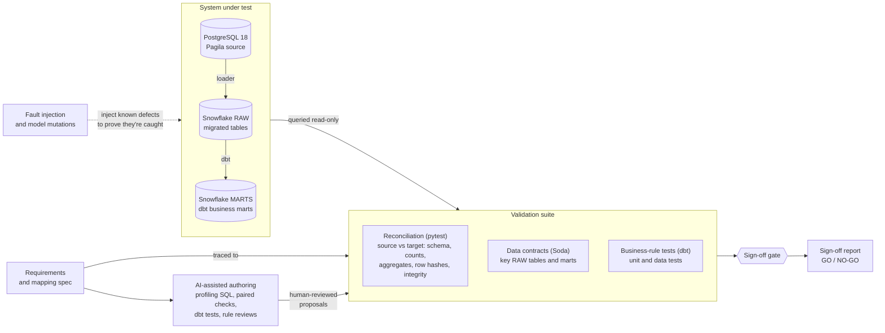

# Pagila → Snowflake migration QA

Data QA automation for a database migration and its ETL. The system under test is deliberately small: the Pagila sample database migrated from PostgreSQL 18 to Snowflake, with three dbt business marts on top. It exists to be tested.

The QA work is the point:
- requirement-traced reconciliation from source to target
- data contracts and business-rule tests
- fault injection that proves the checks catch defects
- a go/no-go sign-off gate run in CI

## At a glance

| | |
|---|---|
| Migration sign-off | **GO**: 17/17 requirements pass, all 5 gate criteria met ([reports/migration_signoff.md](reports/migration_signoff.md)) |
| Fault detection | 12/12 injected migration faults caught ([reports/fault_matrix.md](reports/fault_matrix.md)) |
| dbt test strength | 17/17 model mutations caught ([reports/dbt_mutation_matrix.md](reports/dbt_mutation_matrix.md)) |
| Tests per full run | 166 pytest, 29 dbt (8 unit, 21 data) |
| Defects found in AI output | 50, each with what caught it ([AI_LOG.md](AI_LOG.md)) |
| Snowflake cost to date | 4.6 compute credits on the project warehouse, about $14; 73 MB storage |

## Architecture



| Path | What's there |
|---|---|
| `requirements/` | Requirement IDs (MIG, ETL), known source issues, sign-off decisions |
| `mapping/type_mapping.yml` | Column-by-column Postgres → Snowflake spec and the 9 human mapping decisions |
| `tests/`, `src/reconcile/` | Reconciliation layers, row hashing, the sign-off gate |
| `soda/contracts/` | Data contracts on key RAW tables and the marts |
| `dbt/models/marts/*.yml`, `dbt/tests/` | Business-rule tests: unit and data tests beside each mart, singular tests |
| `src/faults/` | Fault injector and the fault, mutation, and paired-check harnesses |
| `.claude/agents/`, `src/triage/` | AI agents that draft checks and tests, and their read-only query tools |
| `src/migrate/`, `dbt/models/` | System under test: the loader and the dbt models |
| `reports/` | Generated sign-off, fault, and mutation reports |

## Setup

One time. Snowsight steps run as ACCOUNTADMIN.

1. Install Docker, `uv`, and git, and start a Snowflake trial.
2. Create two key pairs (service user and read-only agent user):
   ```bash
   mkdir -p ~/.snowflake
   for k in pagila pagila_triage; do
     openssl genrsa 2048 | openssl pkcs8 -topk8 -inform PEM -out ~/.snowflake/${k}_rsa_key.p8 -nocrypt
     openssl rsa -in ~/.snowflake/${k}_rsa_key.p8 -pubout -out ~/.snowflake/${k}_rsa_key.pub
     chmod 600 ~/.snowflake/${k}_rsa_key.p8
   done
   ```
3. In Snowsight, paste each public key into its script and run `sql/snowflake_setup.sql`, then `sql/snowflake_triage_reader.sql`.
4. Add both connections to `~/.snowflake/connections.toml`:
   ```toml
   [pagila]
   account = "<org>-<account>"
   user = "PAGILA_SVC"
   authenticator = "SNOWFLAKE_JWT"
   private_key_file = "/Users/<you>/.snowflake/pagila_rsa_key.p8"
   role = "PAGILA_ROLE"
   warehouse = "PAGILA_WH"
   database = "PAGILA_MIG"
   schema = "RAW"

   [pagila_triage]
   account = "<org>-<account>"
   user = "PAGILA_TRIAGE_SVC"
   authenticator = "SNOWFLAKE_JWT"
   private_key_file = "/Users/<you>/.snowflake/pagila_triage_rsa_key.p8"
   role = "PAGILA_TRIAGE"
   warehouse = "PAGILA_WH"
   database = "PAGILA_MIG"
   schema = "RAW"
   ```
5. `cp .env.example .env` and fill it in, then `uv sync` and `docker compose up -d`.

## Run it

```bash
docker compose up -d                                        # source Postgres on localhost:5434
uv run --env-file .env python -m migrate.load               # migrate all tables to PAGILA_MIG.RAW
(cd dbt && uv run --env-file ../.env dbt build --profiles-dir .)   # staging + marts, unit and data tests
uv run --env-file .env pytest                               # spec, loader, reconciliation, ETL suite
uv run --env-file .env python -m faults.matrix              # inject each fault, score detection (~8 min)
uv run --env-file .env python -m reconcile.record           # store a suite run in QA.RECON_RESULTS
uv run --env-file .env python -m reconcile.summarize        # Cortex summary of its failures, fact-checked
uv run --env-file .env python -m faults.dbt_mutations       # break dbt models 17 ways, score the dbt tests
uv run --env-file .env python -m faults.pair_matrix DIR     # score a folder of paired SQL checks against the faults
uv run --env-file .env python -m reconcile.signoff          # run everything, write reports/migration_signoff.md (exit 1 on NO-GO)
```

## CI

| Workflow | Runs on | What it does | Needs |
|---|---|---|---|
| `.github/workflows/ci.yml` | every PR, pushes to `main` | ruff, then `pytest -m "not target_db"` (29 tests: mapping spec vs a live Pagila source, loader, row-hash, harness and gate unit tests, dbt traceability) against a PostgreSQL 18 + pgvector service container | nothing |
| `.github/workflows/full-run.yml` | manual (`workflow_dispatch`) | fresh source → `migrate.load` → `dbt build` → `reconcile.signoff`; fails on NO-GO and keeps the sign-off report as an artifact | repo secrets `SNOWFLAKE_ACCOUNT`, `SNOWFLAKE_PRIVATE_KEY` |

Tests that need Snowflake are marked `target_db`. The full run overwrites `RAW`, `STAGING`, and `MARTS`; the first one took 3 min 42 s end to end.

## Reconciliation layers

Cheap to expensive. Each test is tagged with a requirement in `requirements/requirements.yml`, and pytest prints a per-requirement summary.

| Layer | Requirement | What it compares | Catches |
|---|---|---|---|
| Spec | MIG-001 | Mapping spec vs live source catalog | Unmapped columns, source type drift |
| Schema | MIG-002 | `DESC TABLE` vs spec: names, order, types, nullability, virtual, CHECK, PK | Wrong DDL, missing constraints |
| Volume | MIG-003, MIG-006 | Row counts per table; latest load log entry per table | Dropped or duplicated loads, failed runs |
| Aggregate | MIG-004 | Per column: nulls, distinct, min, max, sum | Truncation, shifted values, wrong types |
| Row | MIG-005 | Normalized MD5 per primary key, both sides | Any changed, missing, or extra row, reported by key |
| Integrity | MIG-007, MIG-008 | Orphans for 23 relationships; domain rules | Broken references (Snowflake doesn't enforce FKs) |
| Contract | MIG-009 | Soda contracts on key RAW tables | Rule violations in the target itself |
| Business rule | ETL-001 to ETL-007 | dbt unit tests (edge cases), dbt data tests, and marts vs an independent Postgres implementation | Wrong rule logic, boundary errors, join fan-out or loss |
| Mart contract | ETL-008 | Soda contracts on the three marts | Grain, value sets, fee consistency for consumers |

Proof, from [reports/fault_matrix.md](reports/fault_matrix.md): each of 12 injected faults is caught by at least one layer. The row hash alone catches 11; the exception, a dropped CHECK constraint, is caught by the schema and integrity layers. Aggregates catch 9.

## dbt marts

| Mart | Grain | Rules |
|---|---|---|
| `MARTS.MART_MONTHLY_STORE_REVENUE` | store × UTC month | ETL-001, ETL-002 |
| `MARTS.MART_CUSTOMER_LIFETIME_VALUE` | customer | ETL-003 |
| `MARTS.MART_RENTAL_RETURNS` | rental | ETL-004 to ETL-007: due date, status, days late, late fee |

Rules are written in plain English in `requirements/requirements.yml`. Every dbt test declares its rule in `config.meta.requirement`, and `tests/test_etl_traceability.py` fails if a rule has no dbt test.

## AI in the workflow

### Who authored what

| Artifact | Written by | Validated by |
|---|---|---|
| Profiling SQL, mapping spec, loader, DDL generator | Claude Code (AI) | The human (all 9 mapping decisions), plus live probes in Snowflake |
| Reconciliation layers, row-hash SQL, Soda contracts | Claude Code | Cross-checks with differently shaped queries, negative controls, the fault matrix |
| dbt models, unit/data/singular tests | Claude Code | The human (business-rule decisions), model mutations, an independent Postgres re-implementation |
| Fault injector and matrix | Claude Code | Predictions written down before each run, verified restores |
| Requirements and business rules | Claude Code drafts | The human decides every judgement call (edge cases, attribution, rounding) |
| Code review | Codex (a different model) on PRs #1 to #4 | 15 findings fixed; the human kept 1 design choice |

Almost all code and SQL here is AI-generated. The project's point is proving it correct, and [AI_LOG.md](AI_LOG.md) records every defect found in AI output, with what caught it (50 so far).

### Agents in the QA workflow

Four focused Claude Code subagents (`.claude/agents/`). Each one was evaluated blind against ground truth before being trusted.

| Agent | Job | How it was scored | Result |
|---|---|---|---|
| `dq-triage` | Diagnose a failing check: affected rows, pattern, root cause, fix, earliest catching test | 4 randomly drawn faults, given only the failing output | 31/32; it found a real gap (MIG-006 now recounts tables) |
| `dbt-test-author` | Write dbt unit, data, and singular tests from a model and its ETL rules | 17 model mutations, against the existing tests | 17/17 vs 16/17; **found a real precision bug** in `mart_rental_returns`, now fixed |
| `migration-check-author` | Write paired Postgres/Snowflake validation SQL for tables and MIG requirements | False alarms on clean data, then the 12-fault matrix | 0/17 false alarms; 10/12 faults (all 10 in its brief); two of its ideas were ported into `src/reconcile` |
| `rule-reviewer` | Find the ambiguities in a draft business rule before it's built | Recall against 13 gaps settled in this project | 12.5/13 recall, 14/14 precision, every count exact; found SRC-005 |

How the agents are kept honest:
- **Read-only database access.** Agents query only through `triage.query`, `triage.check_pair`, and `triage.dbt_check`, as Postgres `dq_triage` and Snowflake `PAGILA_TRIAGE_SVC`. Writes were rejected on both, even with read-only mode forced off. `triage.dbt_check` overlays only test files and always uses this repo's profile, so a proposal can't switch to a writable login.
- **Proposals, not edits.** Authors write only to `proposals/<agent>/`. A human reviews the output and promotes what's good into the suite.
- **Blind evaluation.** Workspaces are stripped of the existing tests and answers and checked for leaks; scores come from mutation and fault harnesses (`faults.dbt_mutations`, `faults.pair_matrix`, `faults.matrix`).
- **One shared rule set.** Every agent follows [docs/dq_checklist.md](docs/dq_checklist.md), the traps behind the defects in [AI_LOG.md](AI_LOG.md).

Other AI in the pipeline:
- **AI-generated validation SQL:** written from requirement IDs and human-reviewed. 5 defects, one a latent `DATEDIFF` bug (`reports/ai_sql_review.md`).
- **Cortex `AI_SUMMARIZE_AGG`:** summarizes a recorded run's failures, and the summary is fact-checked for invented or omitted facts. It's the only AI function a trial account allows, at about $0.0007 per call.

Setup for the read-only identities: `docker/init/03-triage-role.sh` (Postgres) and `sql/snowflake_triage_reader.sql` (Snowflake, run as ACCOUNTADMIN). New agent files load only after restarting Claude Code.

## pytest and Soda

**pytest reconciliation** (`tests/`, `src/reconcile/`) compares the Postgres source with the Snowflake target for every migrated table:
- schema against the mapping spec
- row counts and per-column aggregates
- a normalized row hash per primary key
- orphan and domain-rule checks in the target

Failures name the table, column, or key that differs. This is the layer that signs off the migration.

**Soda Core data contracts** (`soda/contracts/`) are declarative YAML checks on one Snowflake dataset at a time: the payment, rental, film, and customer tables in RAW, and the three marts. Each contract asserts:
- schema shape and row count
- required values and uniqueness
- valid values and ranges

pytest runs every contract (MIG-009, ETL-008).

## Row-hash normalization

Hand-written for `payment` in `sql/reconciliation/` (both dialects), generalized in `src/reconcile/rowhash.py`. A test proves the generator matches the hand-written pair row for row.

- NULL is encoded as `0` and a value as `1` + its length + `:` + the value. A `\N` token doesn't work, because Snowflake reads `'\N'` as `N`. The length prefix makes the encoding unambiguous: a separator alone lets two different rows produce the same text.
- Timestamps are UTC with microseconds. Numerics use fixed scale. UUIDs are lowercase.
- Strings are compared untrimmed. Pagila has no `CHAR(n)` columns, so trimming could only hide defects.
- Vectors are rounded to 9 decimals per element: no false mismatches on the 1,000 real embeddings, and a 1e-7 drift is caught.

## Cost

Measured on this trial account on 2026-10-21, where compute is billed at $3.00 per credit (`ORGANIZATION_USAGE.RATE_SHEET_DAILY`). `ACCOUNT_USAGE` lags by hours, so recent runs show up late.

| Item | Measured |
|---|---|
| Project compute (2 days of building and testing) | 4.60 credits on `PAGILA_WH` (`CREDITS_USED_COMPUTE`), about $13.80 |
| Billed for the whole account | 6.34 credits (`METERING_DAILY_HISTORY.CREDITS_BILLED`), about $19; includes the pre-existing `COMPUTE_WH` and cloud services after Snowflake's daily adjustment |
| One CI full run | 3 min 42 s end to end; at most about 0.06 credits (XS bills 1 credit per running hour) |
| Storage | 73 MB in `PAGILA_MIG` (no storage charge on the rate sheet yet) |
| Cortex summary | about $0.0007 per call |

- **Most of the spend is idle time.** Only about 1.5 of the 4.6 compute credits are attributed to queries. The rest is the 60-second minimum each time the warehouse resumes, plus the 60 seconds before it auto-suspends, paid on every short burst of tests. Attribution in `ACCOUNT_USAGE` also lags by hours.
- **Biggest query consumers:** the loader, pytest suite, and fault harnesses (`pagila-migration` tag, 0.69 credits), Soda (0.53), dbt mutations (0.14).
- **Guardrails:**
  - `PAGILA_MONITOR` allows 20 credits a month on `PAGILA_WH`. It notifies at 50% and 75% and suspends at 90%.
  - `ACCOUNT_MONITOR` allows 50 credits a month across every warehouse in the account and suspends at 90%.
  - Every warehouse auto-suspends after 60 seconds.

## Teardown

1. **Stop spending.** In Snowsight: `ALTER WAREHOUSE PAGILA_WH SUSPEND;`. "Invalid state ... cannot be suspended" means it already is. Check `SHOW WAREHOUSES;` for anything else still `STARTED`.
2. **Check what it cost:**
   ```sql
   SHOW RESOURCE MONITORS;   -- used_credits per monitor this month
   -- What was billed, per day and service (cloud services after the daily adjustment)
   SELECT USAGE_DATE, SERVICE_TYPE, ROUND(SUM(CREDITS_BILLED), 3)
   FROM SNOWFLAKE.ACCOUNT_USAGE.METERING_DAILY_HISTORY GROUP BY 1, 2 ORDER BY 1, 2;
   -- Warehouse compute per warehouse (CREDITS_USED would add unadjusted cloud services)
   SELECT WAREHOUSE_NAME, ROUND(SUM(CREDITS_USED_COMPUTE), 3)
   FROM SNOWFLAKE.ACCOUNT_USAGE.WAREHOUSE_METERING_HISTORY GROUP BY 1;   -- lags up to 3 h
   ```
3. **Drop the project:** run [sql/snowflake_teardown.sql](sql/snowflake_teardown.sql) as ACCOUNTADMIN.
   - It drops the database (every schema, including `FAULTS` and `MUT_*`), the warehouse, both users, both roles, and `PAGILA_MONITOR`.
   - `UNDROP DATABASE PAGILA_MIG` works for 1 day (Time Travel). After that the database spends 7 days in Fail-safe, recoverable only by Snowflake support and still billed for storage, then it's purged.
   - It leaves `ACCOUNT_MONITOR` and anything that predates the project.
4. **Local:**
   - `docker compose down -v` deletes the source container and its volume.
   - Delete `~/.snowflake/pagila_rsa_key.*` and `~/.snowflake/pagila_triage_rsa_key.*`.
   - Remove `[pagila]` and `[pagila_triage]` from `connections.toml`, and delete `.env`.
5. **GitHub:** `gh secret delete SNOWFLAKE_ACCOUNT` and `gh secret delete SNOWFLAKE_PRIVATE_KEY`.
